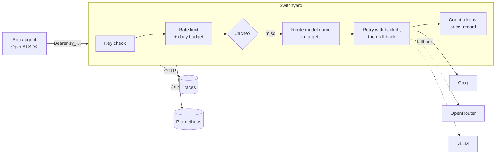

# Switchyard

Switchyard is a small LLM gateway written in Go. It sits between your applications and
OpenAI-compatible model APIs (Groq, OpenRouter, OpenAI, a self-hosted vLLM server) and gives
every request the same handling: API keys with per-key rate limits and daily budgets, retries
with backoff, fallback to another provider, an exact-match response cache, token and cost
accounting, Prometheus metrics and OpenTelemetry traces.

Clients don't change: they keep using their OpenAI SDK and point `base_url` at the gateway.



## Features

- **OpenAI-compatible API**: `POST /v1/chat/completions` (streaming and non-streaming),
  `POST /v1/embeddings`, `GET /v1/models`. Request fields the gateway doesn't know about pass
  through unchanged, and numbers keep their exact value. The same routes are also served under
  `/openai/v1/...`, the path Groq's SDKs use, so a Groq-SDK client only needs its base URL set
  to the gateway's root.
- **Model names you choose**: clients ask for `gpt-oss-120b`; the config maps that name to an
  ordered list of provider/model targets.
- **Retries and fallback**: transient failures are retried with exponential backoff and jitter,
  and the next target takes over when a target keeps failing. A `Retry-After` longer than
  `retry.max_delay` moves on to the next target at once instead of waiting.
- **API keys**: tokens are generated by `switchyard keygen`; the config stores only their
  SHA-256 digests, and comparisons are constant-time.
- **Per-key limits**: a token-bucket rate limit (requests per minute) and a daily spend budget
  in US dollars that resets at 00:00 UTC.
- **Cost accounting**: token counts come from each response's `usage` (for streams, the gateway
  adds `stream_options.include_usage` and reads the final chunk) and are priced per target.
- **Response cache**: exact-match LRU cache with a TTL for embeddings and `temperature: 0`
  chat requests, scoped to the client key.
- **Observability**: one JSON log line per request; Prometheus metrics on a separate private
  listener; OpenTelemetry spans that continue the caller's W3C trace context and use the
  `gen_ai.*` attribute names.
- **Deployment**: distroless container image and a Terraform module for Google Cloud Run sized
  for the free tier.

## Quick start

```sh
make build
./bin/switchyard keygen -name my-app     # prints a token and the config entry for it
cp switchyard.example.yaml switchyard.yaml
# paste the config entry under keys:, then
export GROQ_API_KEY=gsk_...
export OPENROUTER_API_KEY=sk-or-...      # or delete the openrouter provider and target
./bin/switchyard serve -config switchyard.yaml
```

```python
from openai import OpenAI

client = OpenAI(base_url="http://localhost:8080/v1", api_key="sy_...")
reply = client.chat.completions.create(
    model="gpt-oss-120b",
    messages=[{"role": "user", "content": "One sentence on token buckets."}],
)
```

Every response says which target served it and what it cost:

```
X-Switchyard-Target: groq/openai/gpt-oss-120b
X-Switchyard-Cost-Usd: 0.0000036
X-Switchyard-Cache: miss
```

`switchyard check -config switchyard.yaml` validates a config without starting the server.

## How failures are handled

Each target is tried up to `retry.max_attempts` times before the gateway moves to the next one.

| Upstream result | What the gateway does |
| --- | --- |
| 2xx | Return it to the client |
| 400, 413, 422 | Return it to the client. The request itself is wrong, so another provider won't help |
| 408, 429, 5xx, network error | Retry this target with backoff (or its `Retry-After`), then fall back |
| 429 with `Retry-After` above `retry.max_delay` | Fall back right away |
| 401, 403, 404 and other 4xx | Fall back right away. This target is misconfigured or lacks the model |
| Every target failed | `502 all_targets_failed` with the last error |

Once a streamed response has started, it is never retried: the client already has part of it.

Gateway errors use the OpenAI error shape (`{"error": {"message", "type", "code"}}`) so SDKs
raise their usual exceptions: `401 invalid_api_key`, `404 model_not_found`,
`429 rate_limit_exceeded` (with `Retry-After`), `429 insufficient_quota` when the daily budget is
spent, `413 request_too_large`.

## Observability

**Logs**: one JSON line per request on stdout, with key name, model, target, status, attempts,
cache result, tokens, cost, duration and trace ID.

**Metrics** (`-metrics-listen`, default `127.0.0.1:9090`, kept off the public port because the
series include key names and spend):

| Metric | Labels |
| --- | --- |
| `switchyard_requests_total` | `model`, `status`, `cache` |
| `switchyard_upstream_attempts_total` | `target`, `outcome` (`ok`, `client_error`, `retryable`, `fallback`, `network_error`) |
| `switchyard_tokens_total` | `target`, `direction` |
| `switchyard_cost_usd_total` | `key`, `target` |
| `switchyard_request_duration_seconds` | `model`, `stream` |

**Traces**: set `OTEL_EXPORTER_OTLP_ENDPOINT` (OTLP/HTTP) to export spans. Each request
produces a server span plus one client span per upstream attempt (`chat <model>`), with
`gen_ai.provider.name`, `gen_ai.request.model`, `gen_ai.usage.input_tokens` and
`gen_ai.usage.output_tokens`. If the caller sends a `traceparent` header, the gateway's spans
join the caller's trace.

## Deploying to Google Cloud Run

`deploy/terraform/gcp` creates an Artifact Registry repository, a service account, Secret
Manager secrets for the config and provider keys, and a Cloud Run service that scales to zero.
Defaults keep it inside the free tier: one instance at most, 1 vCPU and 256 MiB, CPU billed only
during requests, and old images cleaned up. An optional billing budget alert can be added with
`billing_account`.

Provider keys never pass through Terraform, so they stay out of its state:

```sh
cd deploy/terraform/gcp
cp terraform.tfvars.example terraform.tfvars        # set project_id and config_file
terraform init && terraform apply                    # repository, secrets, IAM; no service yet

# add each provider key named in the provider_key_secrets output
printf '%s' "$GROQ_API_KEY" | gcloud secrets versions add switchyard-groq-api-key --data-file=-

# build and push an image to the repository output, then set image in terraform.tfvars
docker build --platform linux/amd64 -t REPOSITORY/switchyard:v0.1.0 .
docker push REPOSITORY/switchyard:v0.1.0
terraform apply                                      # creates the Cloud Run service; prints url
```

## Performance

On an Apple M3, the gateway adds about 44 µs per non-streaming request over a direct call to a
local fake upstream (median of 10 runs: 78.9 µs vs 34.7 µs). Method, raw output and what isn't
covered: [docs/BENCHMARKS.md](docs/BENCHMARKS.md).

## Limits

- Rate limits, budgets and the cache live in process memory. With several replicas each one
  enforces limits on its own share of traffic, which is why the Cloud Run module defaults to one
  instance. A shared store (Redis) is the next step for horizontal scaling.
- Costs are estimates from the prices in the config and the `usage` each provider reports.
- Streaming requests always receive the final usage chunk (`"choices": []`), even if the client
  didn't ask for it. OpenAI SDKs handle it.

## Development

```sh
make test       # go test -race ./...
make lint       # gofmt + go vet
make bench      # gateway vs direct latency and throughput, local fake upstream
make tf-check   # terraform fmt + validate
```

## License

MIT
